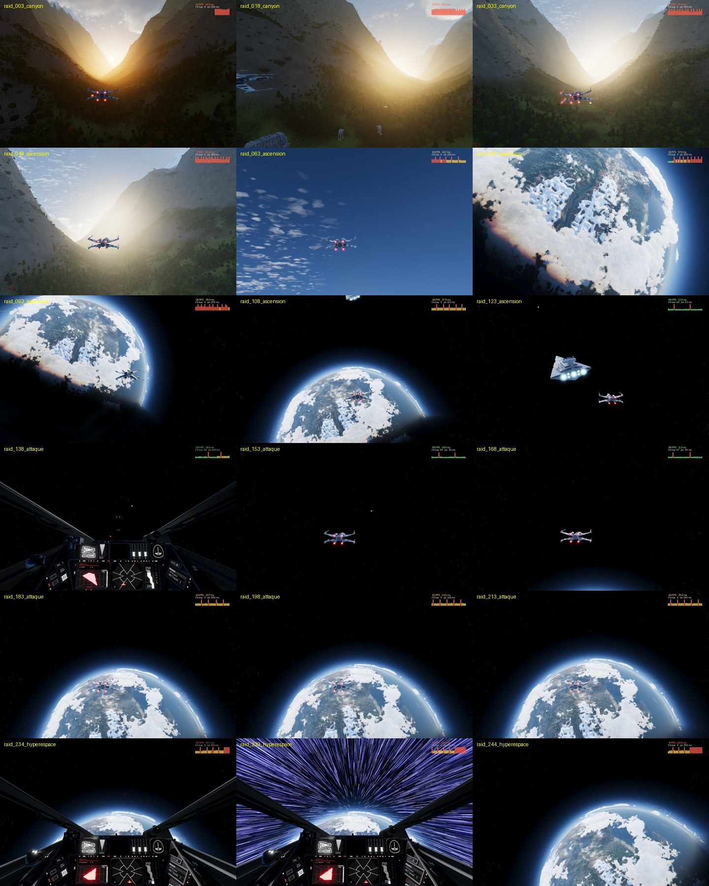
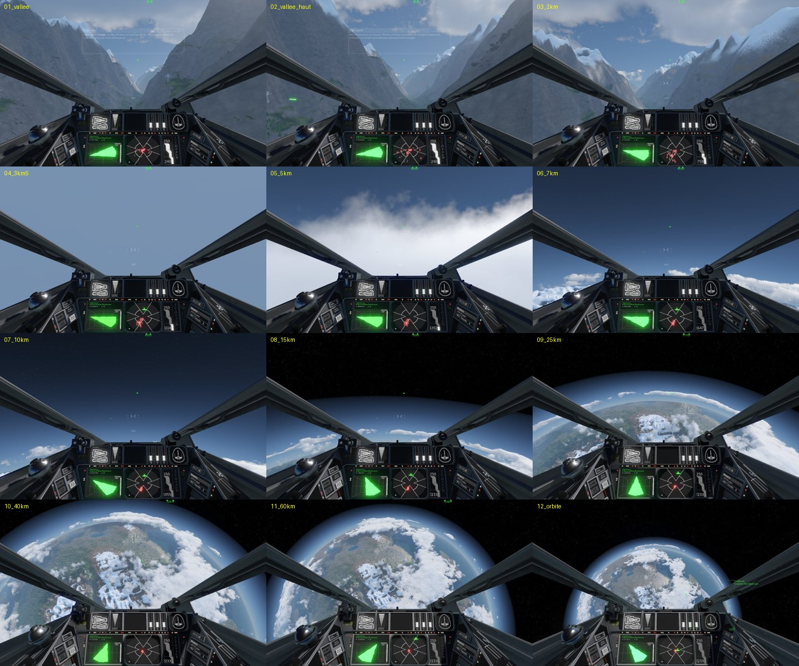
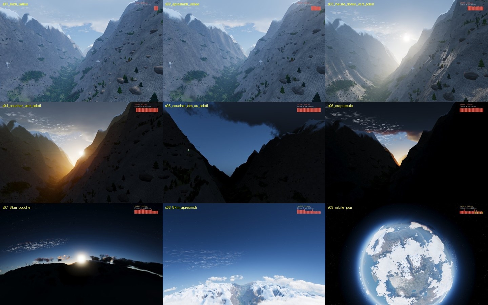
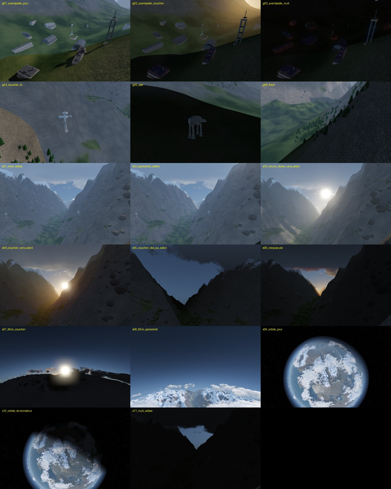

# SpaceSim — prototypes FSO

## Aurore – Évasion (mission jouable, solo et coop jusqu'à 4 joueurs)

Le cargo rebelle *Aurore* fuit par un canyon sous le feu impérial, monte en orbite, puis doit sauter en hyperespace avant que l'Étoile Noire ne détruise la planète. L'escadron Rouge l'escorte en X-wing.



*Le raid d'un bout à l'autre : vol dans le canyon, ascension à travers les nuages, combat en orbite contre le destroyer stellaire, saut en hyperespace.*

| Lanceur | Contenu |
|---|---|
| **Aurore - Evasion.command** | mission jouable (solo), avec briefing et débriefing |
| **Aurore - Evasion coop.command** | menu du jeu : Multijoueur → Héberger → « [Rebel] Aurore - Evasion (coop) » |
| **Aurore - Evasion (cinematique).command** | la cinématique complète |

**En jeu**
- **F10** : vol Arcade (assisté) ou Simulation.
- **Espace** : passer l'intro.
- **Objectifs** : détruire les 10 batteries du canyon (en équipe), protéger l'*Aurore*, puis sauter quand l'ordre est donné.
- **Objectifs secondaires** : la tour de communication (sinon des renforts arrivent) et la navette qui s'enfuit.

**Documentation**
- Plan et état de chaque phase : [docs/PLAN-AURORE-EVASION.md](docs/PLAN-AURORE-EVASION.md).
- Vol de type avion : [docs/VOL-AVION.md](docs/VOL-AVION.md).
- Rendu, performances, armes et crash : [docs/AURORE-03.md](docs/AURORE-03.md).

**Tests automatiques** : `scripts/test_all.sh` (environ 25 min). Il couvre la carte d'altitude, les armes, la cinématique, le crash, le vol, l'IA, la réapparition et la mission complète.


Première mission pour **Fate of the Galaxy 1.1.2**, réalisée avec ses ressources existantes.

## Aurore 03 : planète, atmosphère et nuages « AAA »

Planète de 160 km survolable du sol à l'orbite, sans chargement. Elle a une atmosphère physique avec de vrais couchers de soleil, des nuages volumétriques et un avant-poste impérial avec des tours turbolaser qui tirent, des AT-AT, des forêts et des rochers.

- **Aurore - Vol libre.app** / **Aurore - Sol vers orbite.app** : jeu (F8 trajet auto, F9 vitesse, F7 heure du jour, F6 cycle jour/nuit).
- **Aurore - Qualite max.command** : ombres ultra et MSAA.
- **Aurore - Vitrine.command** : 17 plans cinématiques enregistrés automatiquement.

**Du sol à l'orbite sans chargement** : vue cockpit de la vallée jusqu'à 60 km d'altitude, en traversant la couche nuageuse.



**Atmosphère physique et cycle jour/nuit** : midi, heure dorée, coucher de soleil, crépuscule, vue à 8 km au-dessus des nuages et planète vue depuis l'orbite.



**La vitrine** : l'avant-poste impérial de jour, au coucher et de nuit, une tour turbolaser qui tire, un AT-AT, la forêt, puis la planète au terminateur et la vallée de nuit.



Détails, performances et reconstruction : [docs/AURORE-03.md](docs/AURORE-03.md).

## Terrain 01 : sol et montée continue

Le nouveau prototype est prêt : terrain rocheux **8 × 8 km**, collisions physiques et destroyer à **6 km de hauteur**, dans une seule mission.

- **Terrain - Vol libre.app** pour explorer.
- **Terrain - Demonstration.app** pour une montée automatique d’environ 25 secondes, puis reprendre les commandes.
- **Terrain - FRED.app** pour modifier la mission.

Au briefing : **Commit** ou **Ctrl + Entrée**.

Les contrôles en jeu ont réussi sur le M1 Max. Voir [le guide et les résultats](docs/TERRAIN-01.md) et [le journal conservé](artifacts/terrain/validation-m1max.txt). Le Mac mini M1 reste à tester.

## Escorte Aurore : ouvrir et jouer

Depuis ce dossier dans le Finder :

- **SpaceSim FRED.app** ouvre la mission dans QtFRED 26.2.0.
- **Escorte Aurore.app** lance le jeu sur le briefing de la mission.
- Les fichiers **Ouvrir FRED.command** et **Jouer Escorte Aurore.command** font la même chose via Terminal.

Les lanceurs définissent le dossier de travail avant de démarrer le moteur. Ouvrir directement l'application QtFRED située dans `tools/FSO-26.2.0` peut provoquer l'erreur « cannot be run from a drive root directory ».

Le contenu de Fate of the Galaxy doit rester installé ici :

```
~/Library/Application Support/io.github.KnossosNET.Knossos_NET/FreespaceOpen/FotG_R/FotG_R-1.1.2
```

La mission est également reliée par un lien symbolique au dossier `data/missions/sp` du jeu. Elle porte le nom **[Rebel] Escorte Aurore** dans le simulateur de missions. Le lanceur de jeu fourni utilise FSO 26.2.0 ; le moteur 26.0.1 déjà installé dans Knossos reste disponible.

## Scénario

- **Red 1** : votre X-wing.
- **Red 2** : votre ailier en X-wing, chargé de protéger Aurore.
- **Aurore** : un transport GR-75 transportant du matériel médical.
- **Alpha 1 et Alpha 2** : deux TIE qui attaquent le transport.

Détruisez les deux TIE et protégez Aurore. Cinq secondes après leur destruction, le transport engage son départ en hyperespace. La mission se termine automatiquement six secondes après son départ. Si Aurore est détruit, la mission se termine en échec après sept secondes.

## Modifier la mission dans FRED

Fichier principal : `missions/_SPT_A99_Aurore.fs2`.

1. Ouvrir **SpaceSim FRED.app**.
2. Dans **Scene Browser**, sélectionner **Aurore**, **Red** ou **Alpha**. Déplier les escadrons pour sélectionner les chasseurs.
3. Utiliser **Select and Move (M)** pour déplacer les vaisseaux ; **Zoom Extents (Shift+Z)** pour cadrer la scène.
4. Les menus **Mission** et **Narrative** donnent accès aux objectifs, événements, briefings et messages.
5. Utiliser **Tools → Error Checker** après les changements, puis enregistrer.
6. Relancer **Escorte Aurore.app** pour tester les changements.

Premier exercice : déplacer les TIE plus loin, enregistrer et constater que le joueur dispose de plus de temps pour intercepter l'attaque.

## Fichiers de travail

- `missions/` : mission éditable.
- `scripts/install_mission.py` : crée le lien vers l'installation du jeu, sans remplacer un fichier existant.
- `scripts/create_mission.py` : générateur initial ; **ne pas le relancer après une modification dans FRED**, car il réécrit la mission.
- `scripts/read_lz41.py` : lecture des ressources compressées pour consulter les exemples et les caractéristiques.
- `scripts/launcher.c` : source des petits lanceurs macOS.
- `docs/FotG-FRED-reference.txt` : documentation officielle FotG téléchargée pour cette création.
- `docs/reference/` : copies de référence de tables et missions de l'installation locale.
- `tools/FSO-26.2.0/` : moteur et QtFRED officiels pour Mac Apple Silicon.
- `tools/source/` : code source officiel 26.0.1 consulté pour vérifier le format et les paramètres ; aucune compilation du moteur n'a été nécessaire.

## Vérifications

- Mission ouverte dans QtFRED 26.2.0 avec 5 vaisseaux et 2 escadrons.
- **Tools → Error Checker : No errors found!**
- Briefing et cockpit chargés dans FSO 26.2.0 avec les ressources de FotG.
- La réussite, l'échec et l'équilibrage doivent encore être confirmés par un essai complet.

## Sources

- [Guide FRED de Fate of the Galaxy](https://docs.google.com/document/d/1HRUfu9wU3tmZcbsOGLo27g_7FQWo7xmVteXNrXKk2Ns/edit)
- [Moteur et QtFRED officiels 26.2.0](https://github.com/scp-fs2open/fs2open.github.com/releases/tag/release_26_2_0)
- [Code source du moteur](https://github.com/scp-fs2open/fs2open.github.com)

Les modèles, textures, sons et scripts du jeu restent dans l'installation Knossos. Ce dossier de travail ne constitue pas une distribution autonome du jeu.
